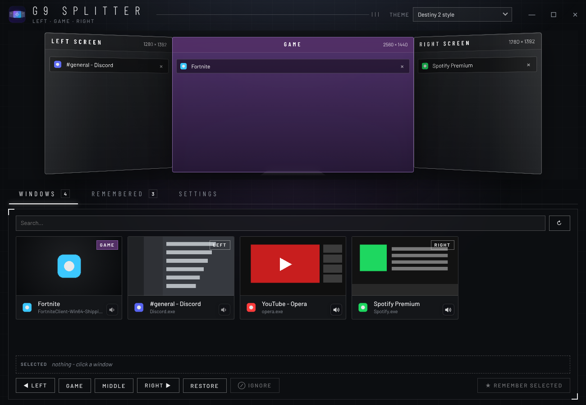
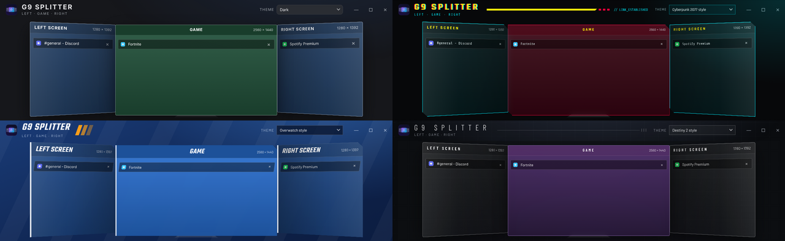

# G9 Splitter

Turn one super-ultrawide monitor (like the 49" Samsung Odyssey G9) into **three screens: Left | Game | Right**. Your game runs borderless in the middle at the size of a 27" monitor, with Discord, Spotify, a browser or anything else on the sides.

## Features

- **Three screens on one monitor.** Drag any window onto Left, GAME or Right and it snaps there.
- **GAME vs Middle.** Games go in the middle without a border and cover the taskbar while you play. Everyday apps get "Middle" instead: they keep their border and stop above the taskbar.
- **Alt+Tab works normally.** Switch away and the game steps back like a normal window. Click it to bring it back on top.
- **Recognises games automatically.** Detection uses where a game is installed (Steam, Epic, Riot, Battle.net, EA, Ubisoft, GOG, Xbox…), its game engine, and Windows' own list of games. Recognised games are put in the middle and remembered.
- **Remembered apps** go to their spot every time they open.
- **Ignore list.** Games you want in real full screen are left completely alone.
- **Any monitor or aspect ratio:**
  - game-area shapes: 16:9, 16:10, 3:2, 4:3, 5:4, 1:1, 21:9, 24:10, 32:9 or a custom size
  - height as a percentage of the monitor
  - left, middle or right position, and top, centre or bottom alignment
  - the preview takes the shape of your monitor
- **Per-app mute** from the window list. It uses Windows' own volume mixer.
- **FPS counter** on the game. It uses Intel PresentMon and reads Windows' frame timing, so nothing is injected into the game.
- **Mouse lock** keeps the mouse inside the game.
- **Hotkeys** for everything (see below).
- **6 themes:** Light, Dark, and fan-made styles inspired by Overwatch, Destiny 2, No Man's Sky and Cyberpunk 2077.
- **Tray icon** and fast start with Windows (straight into the tray).
- **Installs its own updates:** when new files are copied into the app's folder, it restarts itself with the new version.

## Download and run

1. Click **Code → Download ZIP** above and unzip it anywhere.
2. Open the **G9-Splitter-2** folder and double-click **`Start G9 Splitter 2.bat`**.

On the first start it installs Python 3.12 (free, via winget) and pywebview (the app's window) if you don't have them, so you need to be online once. After that there's a "G9 Splitter 2" shortcut with the logo in the folder.

**Requirements:** Windows 10 or 11.

### Set up a game

1. In the game's video settings choose **Windowed** at the size of the game area (2560 x 1440 on a G9).
2. Drag the game onto **GAME** in the app, or just launch it: games are recognised automatically.
3. Alt+Tab or the Windows key gives you a normal desktop. Click the game to go back.

## Hotkeys

| Keys | What it does |
| --- | --- |
| Ctrl+Alt+↑ | Current window to the middle (GAME for games, Middle for apps) |
| Ctrl+Alt+← / → | Current window to the left / right screen |
| Ctrl+Alt+↓ | Back to a normal window |
| Ctrl+Alt+L | Lock / unlock the mouse to the current window |
| Ctrl+Alt+F | FPS counter on / off |

## Classic version

The **classic** folder has the original, simpler version (a plain Windows window, no themes or web view). It has the same features. Don't run both at the same time: they would fight over the same hotkeys.

## Privacy

Everything runs on your PC. There is no account and no telemetry. Settings are saved in `g9_splitter_config.json` next to the app. The only download is Intel's free PresentMon tool, the first time you turn on the FPS counter.

## Notes

- The FPS counter needs admin rights (Windows only allows frame timing for admins). Click **Restart as admin** in the app.
- Theme names describe a visual style only. This project isn't affiliated with or endorsed by Samsung, Valve, Blizzard, Bungie, Hello Games, Rare, CD PROJEKT RED or any other company, and it uses none of their logos or artwork.

## License

[MIT](LICENSE)
